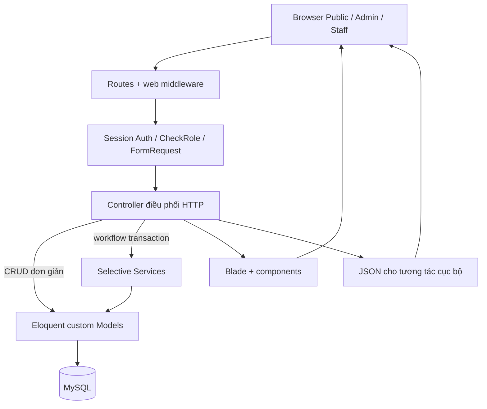
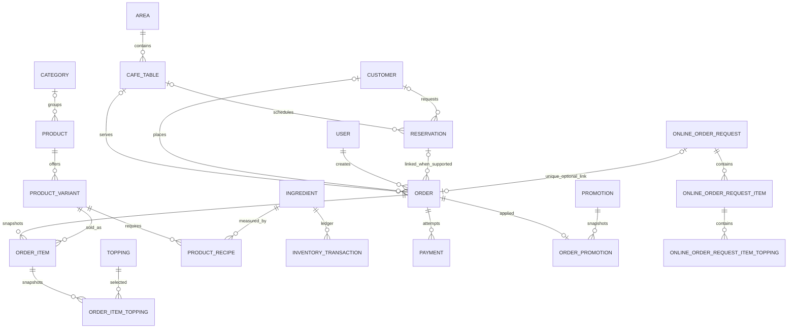

# Coffee Shop Management System — Architecture & Current Implementation

> Bàn giao cho Agent, đối chiếu source ngày **16/11/2026** trên nhánh `feature/area-table-pos-ui`. Tài liệu mô tả **code đang có trong working tree**, gồm thay đổi đã stage nhưng chưa commit; không khẳng định chúng đã merge/deploy hoặc được nghiệm thu production. Không thay thế `requirements.md`, `architecture.md`, `frontend.md`, `plan.md` và `AGENTS.md`.

## 1. Đọc nhanh để tiếp tục công việc

Đây là ứng dụng quản lý một quán cà phê, thương hiệu giao diện Maison du Café, dùng **Laravel monolith + Blade + Eloquent + MySQL**. Kiến trúc chuẩn là **MVC + Selective Service Layer**, không Repository, không SPA/API backend tách riêng. Public phục vụ xem menu, giỏ/yêu cầu pickup và gửi yêu cầu đặt bàn. Admin quản lý dữ liệu/cấu hình; Admin và Staff cùng vận hành POS/Order/pha chế theo quyền đã duyệt.

Các phần đã có implementation đáng kể: tài khoản/quyền; Customer; Catalog; Area/Table; Admin Reservation có kiểm tra lịch; menu điều hướng động; POS/Order/items/topping; công thức và nhập/điều chỉnh/tiêu hao kho; các màn hình thống kê; Floor Plan/detail/gọi món tại bàn; tạm tính/in phiếu tạm tính. **Payment processing, biên nhận thanh toán chính thức và toàn bộ POS end-to-end vẫn chưa hoàn thiện.**

Điểm mới so với báo cáo task09 tháng10: upstream đã có `User::canOperateSales()`, Inventory hardened, nhập kho/kiểm kê, public pickup và schema online/scheduled. Xung đột stash/upstream được xử lý ngày16/11; đọc [báo cáo conflict](conflict-resolution-20261116.md) trước khi sửa Order/Inventory/UI liên quan. Không đưa lại code cũ chỉ vì từng task09 có implementation khác.

### Cách hiểu mức hoàn thiện

| Nhãn | Ý nghĩa |
| --- | --- |
| Có implementation + tests | Source/route/workflow đã hiện thực, có test liên quan; không đồng nghĩa production-ready |
| Có phần nền tảng | Model/schema/hook/màn hình đọc đã có, chưa có workflow đầy đủ |
| Giới hạn môi trường | Có chức năng nhưng bị chặn ngoài local/testing hoặc cần DB phù hợp |
| Chưa hoàn thiện | Thiếu contract/backend/policy/kiểm chứng; Agent không được giả lập để báo hoàn thành |

## 2. Nguồn thẩm quyền và tài liệu

1. Task/prompt được duyệt xác định phạm vi hiện tại.
2. `requirements.md`: nghiệp vụ, bao gồm các approved extensions gần đây.
3. `architecture.md`: trách nhiệm kỹ thuật và model/migration strategy.
4. `frontend.md`: tiêu chuẩn frontend; source nội bộ hiện có theme Sneat cần giữ, không tự redesign.
5. `plan.md`: roadmap/dependencies/task sizing; một số mục lịch sử không phản ánh tiến độ thực tế mới nhất.
6. `AGENTS.md`: quy trình, giới hạn sửa code, evidence/report.

Database: SRS/Frozen `database-design.md` là thiết kế logic được duyệt; migrations là physical schema triển khai. Migration hiện tại không tự hợp thức hóa nghiệp vụ lệch Frozen. Extensions mới phải đọc charter tương ứng. Tài liệu này là **bản đồ implementation**, không tự cấp quyền hay phê duyệt policy mới.

Tài liệu chuyên đề:

- [Area/Table POS architecture](area-table-pos-architecture.md).
- [Task9.7 state matrix](task09/task9.7-state-matrix.md), [task9.9 bugs](task09/task9.9-bugs.md), [task9.9 report](task09/task9.9-report.md): evidence tháng10, cần recheck sau upstream.
- [Online schema](SCHEMA_COUNTER_SCHEDULED_ONLINE.md), `KE_HOACH_SCHEMA_ONLINE_PICKUP_DELIVERY.md`: phân biệt scope schema với workflow.
- `HUONG_DAN_NHAP_KHO.md`, `HUONG_DAN_DIEU_CHINH_KIEM_KE_KHO.md`, `KE_HOACH_VA_HUONG_DAN_INVENTORY_COMPLETION.md`.
- `Rp-seeddata-runMySQL.md`, `database/seed_data.sql`, `database/verify_seed_data.sql`: chạy seed có thể ghi dữ liệu; không tự thực hiện khi chỉ cần đọc context.

## 3. Stack và cấu trúc runtime

| Thành phần | Thực tế |
| --- | --- |
| Framework | Laravel13; CLI đối chiếu hiện tại13.25.0; composer requirement `^13.17` |
| PHP | composer yêu cầu `^8.3` |
| Views | Blade, layouts Public/Auth/Internal; components Public/Internal |
| Frontend | CSS thuần, JavaScript modules, Vite; không React/Vue; không tự cài Bootstrap |
| Persistence | Eloquent, target MySQL; transaction/row locks ở workflows phức tạp |
| Models | Reliese generated Base + custom application models; một số model viết trực tiếp |
| Auth | Session, guard `web`, role middleware; không permission engine granular |
| Tests | PHPUnit12, Laravel feature tests; Node built-in tests; MySQL opt-in; manual Edge CDP harness |
| Tooling | Pint, Tinker, Reliese; manifest/lockfiles quyết định version thực tế |



Simple CRUD có thể Controller→Model. Order/Inventory/Reservation/User safety/Menu tree dùng Service khi có transaction/quy tắc liên nhiều record. FormRequest kiểm tra input/quyền request. Blade không nên query DB. JavaScript chỉ tăng cường UI; không quyết định giá/quyền/payment status.

### Thư mục Agent cần biết

| Path | Vai trò |
| --- | --- |
| `bootstrap/app.php` | Route loading, alias `role`, redirect auth, exception JSON policy |
| `routes/web.php` | Public/auth, groups Admin/Staff; có điều kiện route theo unit-test environment |
| `routes/admin.php`, `routes/staff.php` | Named routes theo module |
| `app/Http/Controllers/{Admin,Staff,Public,Auth}` | HTTP actions |
| `app/Http/Requests/` | Validation/authorization form |
| `app/Services/`, `app/Services/Dashboard/` | Business workflows và read aggregations |
| `app/Models/Base/` | Generated, không thêm business logic thủ công |
| `app/Models/` | Custom relationships/scopes/casts/guarding |
| `resources/views/layouts/internal.blade.php` | Shell Admin/Staff và dynamic sidebar |
| `resources/css/public/coffee-theme.css` | Coffee design tokens gốc |
| `resources/css/internal/sneat.css` | Skin/tokens nội bộ override Public palette |
| `resources/css/{admin,staff}`, `resources/js/{admin,staff}` | Module presentation/enhancement |
| `database/migrations/` | Schema, FK, CHECK, enum, additive changes |
| `config/{auth,models,inventory,admin_menu,maps}.php` | Các policy/config liên quan |
| `tests/{Feature,Unit,JavaScript,manual}` | Regression, module tests, browser/MySQL probes |

Một số source upstream chưa hoàn toàn theo chuẩn kiến trúc, ví dụ route `/` query featured products, public workflows validation/persistence ngay Controller. Đây là **hiện trạng**, không phải mẫu khuyến nghị để Agent tiếp tục sao chép hoặc tự refactor ngoài task.

## 4. Identity, roles và security boundary

- User là tài khoản nội bộ; Customer là hồ sơ khách riêng, không được đồng nhất hai model.
- `CheckRole`: user đã xác thực, status active, role trong nhóm cho phép. Admin routes chỉ Admin; Staff routes cho Admin và Staff.
- `User::canOperateSales()`: chưa soft-delete, active, role admin/staff. Upstream Order/POS/Requests/Inventory đã dùng helper này; giữ lại khi xử lý merge.
- Login dùng email/password/status active, regenerate session, cập nhật last_login_at; logout invalidate session và regenerate CSRF token.
- Role không thay thế business validation: đúng bàn/đơn, pending state, Catalog, stock, duplicate guards vẫn phải kiểm tra server.
- Guard web không cung cấp authorization granular theo ownership Order của từng Staff; không tự áp thêm/chuyển quyền khi chưa có requirement.
- Output Blade escaped; JS dùng textContent; không đưa contact/SQL/secrets vào log/report.

**Finding cần Agent biết:** `/register` hiện public và `RegisteredUserController` tạo **User staff active**, mật khẩu min6, auto login; nếu có phone còn firstOrCreate Customer. Đây không phải Customer auth hoàn chỉnh và khác định hướng “Admin cấp tài khoản nội bộ”. Không tự coi public registration an toàn/được duyệt cho production; engineer cần chốt policy. Admin Create User có validation riêng, không lấy min6 của public register làm policy chung.

## 5. Domain/data map



Sơ đồ định hướng quan hệ, không thay DDL. Xem migrations để biết nullability/FK/constraints chính xác. `pickup_requests` legacy đứng riêng, lưu JSON snapshot items; không phải `online_order_requests`. `admin_menus` self-tree navigation, không phải menu đồ uống.

### Giá trị trạng thái quan trọng

| Entity | Values hiện có / ý nghĩa |
| --- | --- |
| Area | active, inactive |
| CafeTable persisted | available, occupied, maintenance |
| Table display-only | available, occupied, reserved, maintenance, conflict, unknown |
| Order | pending, completed, cancelled |
| Order Item | pending, preparing, ready, served, cancelled; endpoint transition thực tế cần kiểm tra, không phải mọi cặp đều hợp lệ |
| Reservation | pending, confirmed, arrived, completed, cancelled, no_show |
| Payment | pending, paid, failed, refunded; method cash/bank_transfer |
| Product / Variant / Topping | available, unavailable |
| Customer / Ingredient / Category / Promotion | Các status theo migration/request tương ứng, không suy từ table khác |
| Legacy pickup | pending, accepted, cancelled |
| Online request | pending, accepted, rejected, cancelled |
| Order purchase_type extension | counter, scheduled, online; **khác** order_type dine_in/takeaway |
| Inventory movement | import, consume, adjustment, waste |

Master records nhiều nơi dùng SoftDeletes; Order/Payment/lịch sử không được suy là có thể xóa/restore tự do. Relationships với master đã xóa có thể dùng withTrashed để giữ lịch sử. Không sửa Base để thay custom relationship.

## 6. Ma trận nghiệp vụ hiện có

| Module | Đã triển khai | Giới hạn / chưa được kết luận hoàn thiện |
| --- | --- | --- |
| Authentication / User | Login/logout, role/status, CRUD tài khoản nội bộ trừ Delete, khóa/mở, bảo vệ admin cuối | Public register staff cần review; không SSO/permission granular |
| Customer | Listing/search/create/edit/status/soft-delete, giữ lịch sử | Không loyalty points/total_spent; không tự thêm Restore hoặc tái sử dụng phone |
| Catalog | Category/Product/Variant/Topping CRUD/status, upload ảnh, public menu/search/detail | Không coi status auto-derived từ tồn; pricing tại Variant |
| Area/Table | CRUD/status/soft-delete có guard, filters/counts, Floor/detail | Reservation-aware release/POS create còn rủi ro; Floor Admin-only |
| Reservation Admin | Listing/detail/create/availability/approve/cancel | Mutations local/testing-only; chưa arrival→Order/full lifecycle |
| Public Reservation | Gửi yêu cầu liên hệ/guest/time, xác nhận theo session | Workflow riêng, mặc định2h, không gán bàn/check availability qua Admin Service |
| POS/Order | Create empty/createWithItems, items/quantity/topping, progress, cancel | Payment completion/release chưa đủ; replay item cross-client chưa idempotency |
| Table-order | Continue1 pending dine_in, Catalog, draft/save JSON, safe error UI | Không tạo Order mới từ Floor; draft memory-only |
| Checkout/print | Read saved totals/Payment history, phiếu tạm tính | Không thu tiền/official receipt/e-invoice |
| Inventory | Ingredients, recipes, import, adjustment/waste/stocktake/history, consume khi preparing | Không supplier/purchase/holds/topping recipe/auto menu availability |
| Promotions | CRUD + calculation/apply/payment hooks trong Service | Không Payment orchestrator để hoàn thành integration |
| Dashboard | Home operational chart + dedicated statistics | Hai nguồn KPI khác nhau, không được gọi chung net revenue |
| Admin Menu | DB tree CRUD/status/reorder/sidebar | Không RBAC engine; cần dữ liệu menu/migration để hiển thị |
| Public pickup | Session cart→legacy PickupRequest→Staff accepted/cancelled | Chưa tự tạo financial Order/Payment khi accept |
| Online/scheduled | Schema additive + Staff inbox/detail đọc | Chưa submit/accept/convert đầy đủ; không thay legacy pickup tự động |
| Google Maps | Config/component/link vị trí đã duyệt | Link campus HUIT, không tự nhận là café pin riêng; embed phụ thuộc config |

## 7. Các workflow chi tiết

### 7.1 User và Customer

`UserController`, Admin User FormRequests, `UserManagementService`. Service khóa/recheck actor và user, bảo vệ không mất admin active cuối; chỉ whitelist name/email/phone/role/status cho Update. Password được hash qua User cast. Không đưa password/hash vào bàn giao. Routes không có Delete User.

`CustomerController` và requests: thông tin name/phone/email/birthday tùy trường nhưng Create/Edit yêu cầu ít nhất name/phone/email theo policy đã duyệt. Phone unique chịu cả bản ghi đã soft-delete; xóa mềm không sửa/hủy Order/Reservation. Không thêm loyalty vì schema Frozen không có points/total_spent.

### 7.2 Catalog

`CategoryController`, `ProductController`, `ProductVariantController`, `ToppingController`, FormRequests tương ứng. Product là metadata/category/image/availability; Variant là tên size/SKU/**price**. Order snapshot tên/giá khi lưu, không đọc lại Catalog hiện tại để viết lại tiền lịch sử. Topping chung, snapshot qua order_item_toppings. Upload image qua storage conventions, không hardcode filesystem path hoặc URL tạm. Public menu lọc dữ liệu bán được; điều kiện active Category có thể khác các đường nội bộ, phải đọc query cụ thể khi sửa.

### 7.3 Area/Table management

`AreaManagementService`: soft-delete Area chỉ khi không có CafeTable liên kết, kể cả bàn đã xóa mềm. Đổi active/inactive không cascade sửa/hủy bàn/giao dịch.

`CafeTableManagementService`: kiểm tra trạng thái, pending Orders và live/future Reservations khi edit/delete/manual status. Policies trước: giảm capacity không dưới guest_count lịch còn hiệu lực; không đổi Area khi occupied/pending Order/lịch còn hiệu lực; chuyển Area mới phải active. Delete soft chỉ available/maintenance không pending Order/lịch live, occupied bị chặn; giữ mã bàn. Đọc Service/requests để xác nhận exact guards sau mỗi update.

Manual status có expected_status, cho available→maintenance, maintenance→available, occupied→available theo điều kiện; không cho dùng UI để tự đánh occupied/reserved. Không nhầm guard của Admin management với guard OrderService/POS — chúng không tự động giống nhau.

### 7.4 Reservation

Admin services: `ReservationCreationService`, `ReservationAvailabilityService`, `ReservationApprovalService`, `ReservationCancellationService`.

- Create nhập start/end theo timezone ứng dụng; end>start, start tương lai, table capacity và Area active/nondeleted, không maintenance, Customer active nếu chọn.
- Chống trùng khoảng `[start,end)`: pending/confirmed/arrived chiếm lịch; completed/cancelled/no_show không chiếm; lịch tiếp giáp được phép, không tự thêm buffer.
- Transaction/locks và kiểm tra lại sau chờ khóa; approve pending→confirmed, revalidate.
- Cancel chỉ pending/confirmed, expected_status phải khớp; chặn khi có bất kỳ Order liên kết qua reservation_id; không ghi đè note/lý do ngoài policy.
- **Create/approve/cancel Admin còn local/testing restriction**. Không bỏ guard khi deploy chỉ để làm nút dùng được.

Public `/reservation` hiện là Controller riêng: khách nhập contact/guest/start, tạo end=start+2h, không gán bàn. Không được tuyên bố flow public đã được availability-check hoặc mang đầy đủ semantics của Admin. Đây là điểm integration/policy cần review trước production.

### 7.5 POS, Order, items và pha chế

`PosController`: session cart của nội bộ, chọn Variant/quantity, checkout gọi `OrderService::createWithItems()`; chữ checkout ở đây là **tạo Order**, không thu tiền. Không đưa persistence Controller cũ trở lại sau merge.

`OrderService::create()` kiểm tra active sales actor, Customer nếu có; dine_in cần Area active/bàn available và không pending dine_in khác, khóa dữ liệu, tạo pending Order và chuyển bàn occupied trong transaction. takeaway không gắn bàn theo FormRequest. `createWithItems()` tạo Order và snapshots cùng transaction.

`addItem`/update/remove/topping kiểm tra quan hệ, pending Order và món còn chỉnh được; lấy Variant/Product/Topping hiện tại, dùng giá server, snapshot và recalculate. Quantity/amount có overflow bounds; money tính theo đơn vị nhỏ nhất thay vì tin float client. Topping của line có quantity/snapshot riêng.

Tiến độ: pending→preparing qua InventoryService; preparing→ready→served theo allowed transitions. Pha chế hiển thị các items pending/preparing/ready của Orders chưa đóng. Không chuyển Order completed chỉ vì mọi món served nếu chưa có accepted financial lifecycle.

Cancel chỉ pending Order và items đều pending; giữ lịch sử. Nhánh release hiện dựa không còn pending dine_in khác rồi có thể đổi occupied→available. **Chưa thấy guard Reservation trong nhánh này**: finding cũ còn cần owner xử lý. Không coi available sau cancel là bằng chứng bàn có thể nhận khách.

### 7.6 Gọi món tại bàn và status read model

`TableOrderContext` đọc đúng table/order dine_in, cho continue pending duy nhất1, bàn available/occupied và Area active. Save khóa/recheck actor/Area/Table/Order, delegate OrderService. Read helper/actor guards phải đối chiếu code hiện tại; không tự thay `canOperateSales()` ở upstream bằng check role rời rạc.

`TableOrderController` GET HTML/JSON, POST item201 với saved_item_id/snapshot. Filters/search lấy Catalog; save chỉ nhận variant_id/quantity/note, server không nhận client total/price làm authoritative.

JS `resources/js/staff/table-menu.js`: draft memory-only, saved và draft phân biệt; từng dòng save tuần tự, chỉ bỏ dòng có ack; lỗi xác định giữ dòng chưa lưu, timeout/mất response khóa uncertain draft không auto retry. Read GET có loading/guard/timeout; trước rời trang có beforeunload. Resize/native details không mất draft. **Không có idempotency nhiều tab/máy được chứng minh**.

`TableStatusReadService` dùng một CASE SQL cho Floor/detail/Area; display không ghi database:

| Dữ liệu | Display |
| --- | --- |
| Area inactive/missing/deleted hoặc persisted lạ | unknown |
| Nhiều pending dine_in; available có Order; occupied không Order | conflict |
| maintenance có Order/lịch hiện tại; Order cùng lịch hiện tại | conflict |
| available,0 Order,có lịch hiện tại | reserved |
| Còn lại | available/occupied/maintenance theo persisted |

Lịch hiện tại: pending/confirmed/arrived, start<=observedAt<end. Future count riêng, không tự reserved tương lai. Payment counts chỉ tham chiếu, không tự waiting_payment/paid/release. GET refresh giữ filter và reload một lần khi bfcache khôi phục; không WebSocket/polling. Các SELECT/page khác nhau không được hứa cùng snapshot giao dịch.

Staff `/staff/tables` là màn hình danh sách riêng; không tự mặc định đã dùng display resolver Floor Admin. Dashboard table statistics cũng có contract persisted riêng.

### 7.7 Checkout / Payment / chứng từ

`TableCheckoutController`: GET summary/estimate cho active Admin/Staff, table/order phải đúng dine_in. Đọc saved items/topping/totals và Payment rows phân trang10; không cộng trừ dư nợ, không xác minh paid chỉ từ row/query parameter.

`estimate-items`/`estimate-print`: **Phiếu tạm tính — không phải biên nhận thanh toán/hóa đơn điện tử**. In bằng browser dialog, không ghi Order/Payment/Table; mở dialog không chứng minh in vật lý. Không có PaymentService/PaymentController/command thu tiền đầy đủ trong source khảo sát. Payment model/table/history và hooks Promotion không tương đương payment processing.

### 7.8 Inventory / Recipe

`IngredientController`: master data + low/out-stock indicators/filter; CRUD không trực tiếp sửa current_stock. Đơn vị có chuẩn g/kg/ml/l/cái và lựa chọn other theo validation hiện có, không tự quy đổi. Đổi unit bị hạn chế khi có stock/recipe/ledger.

`ProductRecipeController`: cấu hình ingredients cho mỗi Variant, định lượng mỗi phần>0, precision3 decimals, unique variant+ingredient; không đổi kho khi sửa recipe. Nguyên liệu inactive/deleted cũ được cảnh báo; không thêm mới từ danh sách không hợp lệ.

`InventoryService::startPreparing()`:

1. Khóa/recheck actor bán hàng, Order pending và Item pending.
2. Chặn nếu đã có ledger consume của order_item; recipe bắt buộc, không cho empty recipe bypass.
3. Tính recipe quantity×item quantity với độ chính xác phần nghìn, khóa Ingredients theo ID.
4. Recheck active/tồn đủ, không stock âm.
5. Cập nhật stock, ledger consume với before/after/actor/reference và item preparing trong một transaction; lỗi rollback toàn bộ.

Morph map `order_item` được đăng ký trong AppServiceProvider; không đổi reference_type tùy ý.

Nhập kho: StockImportController + StoreStockImportRequest → `recordImport`, encrypted operation token gắn actor/ingredient/unit/key, chống cùng phiếu cộng hai lần, qty dương, ledger+stock atomic.

Điều chỉnh: StockAdjustmentController + request → `recordAdjustment`: tăng/giảm, waste, stocktake; reason bắt buộc; chống lặp; stocktake đối chiếu unit/stock/ledger để chặn trang cũ, không tạo movement0. History đọc, không CRUD ledger để sửa lịch sử. Không có supplier/purchase order/auto availability/holds; chưa có recipe tiêu hao riêng cho topping.

### 7.9 Promotion và Dashboard

Promotion CRUD đã có. PromotionService có previewDiscount/applyToOrder/lockPromotionForPayment/consumeUsageAfterPaid: kiểm tra pending Order, status/time/minimum/cap/usage, snapshot một promotion/Order. Hook tăng used_count liên quan paid/refunded có paid_at để tránh dùng lại; Agent phải đọc exact transaction contract trước nối Payment. Không mặc định hook tự chạy qua một endpoint chưa có.

Dashboard có **hai nguồn khác nhau**:

- `/admin`: DashboardController::home, chart7 ngày và số liệu dựa **Orders completed/total_amount/completed_at**, counts operational và recent Orders.
- `/admin/dashboard`: OrderStatisticsService đếm status toàn thời gian; RevenueStatisticsService tổng Payment paid, từ chối KPI khi nhiều paid cùng Order hoặc aggregate không chính xác; TableStatisticsService đếm **persisted table status**, không phải sáu display buckets Floor.

Không đồng nhất order-completed chart với tiền thực thu/net revenue; không đổi semantics KPI chỉ để làm số giống nhau.

### 7.10 Dynamic Admin Menu

`AdminMenu`, AdminMenuController/requests, AdminMenuManagementService, AdminMenuWriteLock, AdminMenuSidebarService + component.

- Tree group/link, tối đa3 cấp; chỉ group có con; route link phải whitelist Admin GET không tham số.
- Cha inactive ẩn nhánh không cascade cập nhật con.
- Chỉ delete leaf không protected; protected routes home/dashboard/menu và ancestors giữ an toàn/recovery.
- Create/update/status/delete/reorder dùng shared MySQL advisory lock xuyên transaction; reorder toàn cây có fingerprint chống stale/missing/duplicate/cycle/depth.
- Sidebar DB-driven, fallback thông báo unavailable và link quản lý menu; không tự seed/navigation mutation khi render.
- permission_key hiện chưa có permission registry thực thi; navigation không thay middleware authorization.

### 7.11 Public cart / pickup / online schema

**Luồng legacy đang chạy**: Public menu → session customer_cart (VariantID/quantity) → server recalculate/filter availability → submit contact/pickup time/note → `PickupRequest` lưu JSON snapshots/subtotal → confirmation chỉ truy xuất theo session. Staff `/staff/pickup-requests` accepted/cancelled khi pending. Accept chỉ đổi request status, không đồng nghĩa đã tạo Order, thu tiền hoặc trừ kho. Cart hiện có float conversion trong money path riêng, không được suy toàn hệ thống đều dùng cents thuần.

**Online schema extension26/10**: online_order_requests/items/item_toppings + orders.purchase_type/online_request_id. Request scheduled có giờ, online không giờ; prepaid chỉ bank_transfer; submission_key/token hash unique, orders.online_request_id unique/FK; accepted/rejected constraints. Hẹn lấy không dùng reservations. Cần MySQL CHECK enforced, migrations mới không chạy như full schema SQLite. Rollback có thể từ chối khi có business history.

Staff OnlineRequestController chỉ inbox/detail đọc DB tables, kiểm tra schema có sẵn; chưa thấy command submit/accept/reject/convert-to-Order của schema mới. Không có custom OnlineOrderRequest models/workflow Service đầy đủ. Không trộn model legacy PickupRequest vào schema mới hoặc dùng trạng thái accepted làm paid.

Public cart/reservation routes bị loại khi runningUnitTests; tests tương ứng đăng ký route riêng. `route:list` ở local khác route collection trong testing. Đây là hiện trạng cần nhớ khi viết tests; không suy route không tồn tại chỉ vì test mode không load.

## 8. Routes để Agent định vị

| Khu vực | URL chính | Quyền/chức năng |
| --- | --- | --- |
| Public | `/`, `/menu`, `/menu/{slug}` | Home/menu/detail, khách |
| Public | `/cart`, `/checkout`, `/checkout/confirmation` | Legacy pickup cart/request, không Payment |
| Public | `/reservation`, `/reservation/confirmation` | Public yêu cầu chưa gán bàn |
| Auth | `/login`, `/register`, POST `/logout` | Chú ý registration policy |
| Admin | `/admin`, `/admin/dashboard` | Hai loại dashboard |
| Admin | `/admin/users`, `/admin/customers` | Internal accounts/customer master |
| Admin | `/admin/areas`, `/admin/tables` | Area/Table CRUD |
| Admin | `/admin/tables?view=floor`, `/admin/tables/{id}/detail` | Read display và active Order link |
| Admin | `/admin/reservations` | Listing/detail; mutations có môi trường guard |
| Admin | `/admin/categories`, `/admin/products`, `/admin/product-variants`, `/admin/toppings` | Catalog |
| Admin | `/admin/promotions`, `/admin/ingredients` | Promotion/Inventory master |
| Admin | `/admin/ingredients/{id}/history`, `/import`, `/adjustment` | Kho |
| Admin | `/admin/product-variants/{id}/recipes` | Recipe canonical group; còn alias recipe/recipes/view cần đọc route cụ thể |
| Admin | `/admin/menus` | Navigation tree, không Catalog |
| Staff/Admin | `/staff`, `/staff/orders`, `/staff/orders/create` | POS/Order |
| Staff/Admin | `/staff/orders/{order}` | Details/items/topping/progress/cancel/Payment history |
| Staff/Admin | `/staff/tables/{table}/orders/{order}/menu` | GET Catalog/JSON summary |
| Staff/Admin | `/staff/tables/{table}/orders/{order}/items` | POST lưu dòng món |
| Staff/Admin | `/staff/tables/{table}/orders/{order}/checkout` | GET tạm tính |
| Staff/Admin | `/staff/tables/{table}/orders/{order}/estimate` | GET proforma |
| Staff/Admin | `/staff/tables`, `/staff/brewing`, `/staff/reservations` | Operational lists |
| Staff/Admin | `/staff/pickup-requests`, `/staff/online-requests` | Hai nguồn request khác nhau |

GET không được dùng để tạo business Order/Payment. Không suy URL từ tên tab; chạy `artisan route:list` khi cần exact method/name/parameter/scoped binding.

## 9. Frontend contract để tiếp tục đúng hướng

- Public là coffeehouse warm/editorial theo frontend.md; Internal hiện Sneat skin override tokens. Không coi modern POS request là quyền đổi theme toàn site.
- Tái sử dụng `x-public.button`, `x-internal.icon`, layouts/cards/forms; tránh thêm framework/component trùng.
- Area/Floor/menu/checkout có scoped CSS; `table-pos-polish.css` sửa specificity/touch targets48px mà không đổi shell global.
- Cart inline native details, không overlay modal; resize giữ DOM/draft. Shared mobile sidebar có Escape/backdrop nhưng focus trap/inert/return focus chưa đầy đủ.
- Print CSS riêng, screen mobile table transformation không làm biến print thành card; giữ số tiền/mã, không sidebar.
- Maps dùng config/maps.php và Public ShopLocation component; view link đến HUIT đã được user chọn, không tự gán pin café chính xác. Không cần key cho share/embed URL; embed render tùy validated configuration.
- Internal layout có fallback bundles khi chưa có manifest; sửa resources nhưng chưa build có thể khiến người dùng nhìn bản bundle cũ. Không chỉnh vendor/node_modules/public build thủ công để chữa source.

## 10. Test/evidence hiện hành

Lần chạy trực tiếp trong lượt lập tài liệu này ngày16/11/2026: `artisan --version` xác nhận13.25.0; `artisan route:list --json` chạy thành công; `artisan test --compact` phát hiện466 tests, **458 PASS,8 SKIPPED,6.542 assertions,0 failures**,25.136s. Evidence local: `storage/logs/agent-context-routes-20261116.json` và `storage/logs/agent-context-tests-20261116.txt`. Test fixtures cô lập theo cấu hình/safety guards hiện có; không chạy migration/seed/ghi MySQL thật trong lượt này.

Evidence lịch sử phải ghi đúng thời điểm:

- Task9.9 tháng10:416 PHP PASS/2 skipped,11 JS PASS,32 browser viewport checks; final acceptance NOT READY do dependencies.
- Conflict integration16/11: báo cáo458 PASS/8 skipped,11 JS PASS/build/lint/Blade compile; browser CDP timeout, responsive **chưa được xác minh lại trên bản merge**. Không dùng ảnh tháng10 để khẳng định bản tháng11 đã responsive PASS.
- Một số MySQL tests là opt-in/dedicated disposable schema; SQLite xanh không chứng minh row-lock/concurrency/CHECK MySQL.
- `tests/manual/table-order-mysql.php` và browser harness là scripts cần đọc guard/profile/target trước chạy; không tự chạy vì tên có chữ test.
- Seed data/demo tài khoản không chứng minh workflow; không ghi credentials vào tài liệu Agent.

Test families: Authentication/Role/User; Customer; Category/Product/Variant/Topping; Area/CafeTable; Reservation; POS/StaffOrder; TableOrder/TableCheckout/TableStatus; Ingredient/Recipe/Import/Adjustment/Inventory; Promotion; Dashboard; AdminMenu/Sidebar; PublicMenu/Maps/CustomerPickup; OnlinePickupSchemaMySql. Xem file test để biết fixture/custom schema và branches bị skip.

### Commands an toàn thường dùng trên máy này

```powershell
# Trong thư mục dự án; kiểm tra file executable tồn tại nếu môi trường thay đổi.
$php = 'D:\Applications\laragon\bin\php\php-8.3.33-Win32-vs16-x64\php.exe'
& $php artisan --version
& $php artisan route:list
& $php artisan test --compact
# Targeted example:
& $php artisan test --compact --filter=TableOrderIntegrationTest

# Build source nếu task chạm frontend; không cài deps mới tự động.
$env:Path = 'D:\Applications\laragon\bin\nodejs\node-v22;' + $env:Path
& 'D:\Applications\laragon\bin\nodejs\node-v22\npm.cmd' run build
& 'D:\Applications\laragon\bin\nodejs\node-v22\node.exe' --test tests/JavaScript/*.test.mjs
```

Không chạy composer setup/migrate:fresh/db:wipe/seed/migrate theo thói quen. Có dependency rồi không cần reinstall. Không mở `.env` và in secrets để biết connection; chỉ đọc config cần thiết một cách có kiểm soát. Không đưa config hiện tại của máy này thành cấu hình mặc định cho Agent khác.

## 11. Gaps/rủi ro bắt buộc giữ trong context

1. Payment controller/service/confirmation/idempotency/official receipt còn thiếu. Không tạo nút Paid giả, không dùng status row/print làm payment proof.
2. Repeated item POST chưa có request idempotency nhiều client; frontend single-page guard không xử lý hết. Diagnostic tháng10 tạo hai dòng khi replay; current save path vẫn delegate addItem, cần recheck thực nghiệm nếu sửa.
3. Order cancel release bỏ qua Reservation trong source khảo sát; Floor conservative display không sửa writer. Manual Table management có guard riêng, không suy coverage cho Order/POS.
4. Order create path chưa chứng minh chống walk-in trùng lịch Reservation đầy đủ; public/Staff/Admin Reservation còn khác nhau. Không tự đổi policy duration/arrival/release.
5. Public registration tạo staff active; cần engineer security/requirement decision, không âm thầm sửa khi chỉ đọc/tài liệu.
6. Public legacy pickup và online request schema tồn tại đồng thời; chưa có full conversion/payment workflow của schema mới.
7. Dashboard Home completed-Order KPI khác paid-Payment KPI và Floor display counts khác persisted dashboard counts.
8. Generated Base có nguy cơ bị regenerate; config/models.php/Reliese cần inspect trước đổi generation. Không chạy generator toàn bộ khi sửa một relationship.
9. Latest merged UI chưa browser verified do CDP timeout; MySQL concurrency còn opt-in skips.
10. Phân công owner trong tài liệu cũ mâu thuẫn: task09 gán Đạt POS, Ninh Catalog, Hợp Auth/Inventory; schema26/10 gán Ninh POS/online, Hợp Catalog/Inventory, Đạt Payment/Promotion, Toàn Auth/Table. **Không chọn im lặng**; hỏi engineer owner hiện tại trước mở scope liên module. Không đọc file Downloads chưa được cung cấp như authority tự động.

## 12. Agent nên bắt đầu như thế nào

1. Đọc task hiện tại + tài liệu này + quy định bắt buộc; xác định đang sửa workflow nào, đừng triển khai mọi gap.
2. `git status`, branch/HEAD, diff staged/unstaged và conflict markers; working tree hiện có rất nhiều staged work, không reset/add/commit hàng loạt.
3. Inspect route → middleware/request → Controller → Service/custom Model → migration → Blade/JS/tests của đúng workflow.
4. So sánh code với báo cáo gần nhất, đặc biệt conflict16/11. Report/task title là lịch sử, không source of truth runtime.
5. Chốt policy/owner nếu thật sự thiếu; không hỏi lại approval đã có trong session khi vẫn cùng scope.
6. Implement tối thiểu, tests/build đúng phạm vi và safe DB target, review diff, report PASS/FAIL/UNVERIFIED/blockers trung thực.
7. Không tự cài package, đổi schema, mở quyền, refactor domain khác, commit/push/merge hoặc làm task tiếp.

### Prompt ngắn dùng để nạp context

> Đọc docs/AGENT_PROJECT_CONTEXT.md cùng AGENTS.md, architecture.md, requirements.md, plan.md và frontend.md nếu liên quan UI. Đối chiếu git status/HEAD/source hiện tại; giữ nguyên staged work. Phân biệt implementation thực tế với schema-only, test evidence lịch sử và nghiệp vụ chưa nghiệm thu. Đọc conflict-resolution-20261116.md trước sửa Order/Inventory/POS. Chỉ triển khai task tôi giao, không tự giải quyết mọi gap hoặc mở scope backend/auth/schema.

## 13. Phạm vi của lượt viết tài liệu này

Chỉ tạo tài liệu này; không sửa source/schema/config/env/route, không commit/push. Không xác minh live database/migration status, không chứng minh production readiness. Các finding ngoài phạm vi được ghi để Agent nhận biết, không được tự sửa. Build/browser không chạy lại vì không thay frontend; không tuyên bố visual verification mới.

### Documentation task report

| Mục | Kết quả |
| --- | --- |
| Task Status | SUCCESS cho tài liệu snapshot; không phải SUCCESS nghiệm thu toàn hệ thống |
| Task ID | AGENT-CONTEXT-20261116, nhãn bàn giao cho yêu cầu hiện tại, không thay roadmap |
| Files Created | docs/AGENT_PROJECT_CONTEXT.md |
| Files Modified / Deleted | None |
| Checks | Source/routes/service/model/migration/test inventory; version/routes/full test; Git diff/status review |
| Acceptance | PASS: architecture thực tế; PASS: workflow và file map; PASS: phân biệt implemented/partial/missing; PASS: evidence có thời điểm; PASS: giữ source/user work |
| Risks / Blockers | Các gaps mục11; không có blocker tạo tài liệu; còn blocker nghiệp vụ/owner cho phát triển tiếp |
| Assumptions | None promoted to policy; snapshot working tree, không khẳng định đã deploy |
| Out-of-Scope Findings | Public staff registration; Reservation/public integration; Payment/release; owner assignment conflicts — chỉ ghi nhận |
| Unverified Items | Live DB/schema applied, MySQL opt-in8 skips, current browser responsive và production readiness |
| Engineer Review Required | Xác nhận phân công hiện tại, registration policy và readiness từng module; cập nhật snapshot khi source đổi |
| Recommended Next Task | Engineer chọn một task riêng từ gaps; không tự triển khai |
