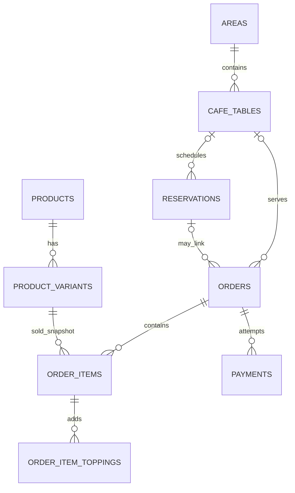

# Area & Table POS — Architecture & Integration Planning

TASK9.1 · 20/10/2026 · **Architecture survey complete; full POS integration NOT READY.** This document proposes integration, not implemented UI/APIs. EXISTING means source/route exists, not production acceptance. PARTIAL means implementation covers only part of a use case. MISSING means not found in inspected routes/controllers/services/views. PROPOSED is a contract for owner approval. BLOCKED means dependent work cannot proceed safely without it.

## 1. Project and evidence

Branch `feature/area-table-pos-ui`; installed Laravel 13.25.0, PHP ^8.3, Blade/Vite, MySQL, MVC + Selective Service Layer. Initial worktree: only untracked docs/task09/. No branch switch. Custom models live in app/Models and extend generated app/Models/Base where applicable. Route modules: routes/web.php → routes/admin.php and routes/staff.php; controllers under Admin/Staff/Public; services under app/Services. Internal shell: resources/views/layouts/internal.blade.php, existing Sneat UI and dynamic Admin navigation. Staff has existing POS, table map, orders, brewing and reservations views.

Authority: requirements.md (FR03/04/06/08, current Order/Payment baseline and Admin/Staff responsibility), architecture.md (thin Controller/selective Service, no DB/business logic in Blade), frontend.md (existing tokens/components/375–768–1440 widths), plan.md (Order→Payment→UI integration dependencies). New modern POS layouts must reuse approved tokens and existing shell; commercial reference is interaction inspiration only. No assets/code/design copied. If later tasks demand a conflicting visual language, engineer must resolve it before UI changes.

Key inspected implementation:
- app/Http/Controllers/Admin/AreaController.php; AreaManagementService.php.
- app/Http/Controllers/Admin/CafeTableController.php; CafeTableManagementService.php.
- app/Http/Controllers/Staff/OrderController.php; app/Services/OrderService.php; app/Http/Requests/Order/*.
- app/Http/Controllers/Staff/PosController.php and WorkspaceController.php.
- app/Services/Reservation{Creation,Availability,Approval,Cancellation}Service.php; Admin/ReservationController.php.
- app/Services/PromotionService.php (payment hooks, not Payment orchestration).
- app/Models/{Area,CafeTable,Order,OrderItem,OrderItemTopping,Payment,Reservation,Product,ProductVariant}.php and Base layers.
- migrations 2026_08_14_000002/000006 (Area/Table), 2026_08_16_000015–000019 (Reservation/Order/Items/Toppings/Payment).
- resources/views/staff/{home,tables/index,orders/{index,create,show}}.blade.php.
- tests/Feature/{StaffOrderManagementTest,StaffOrderItemManagementTest,CafeTableStatusTest,RoleAuthorizationTest}.php plus existing Reservation/Area/Table test suites.

## 2. Module inventory

| Module / owner | Existing implementation | Status for table POS |
| --- | --- | --- |
| Area / Toàn | Area CRUD/views; Area::cafeTables; soft-delete blocked even by soft-deleted tables; status edit changes Area only | EXISTING master data; area-card counts/read DTO MISSING |
| CafeTable / Toàn | Admin CRUD/status service, staff/tables read view; Area FK, capacity, persisted state | EXISTING; operational detail and active-order selection PARTIAL |
| Order / Đạt | OrderController + OrderService create/show and pending item/topping mutations; table locking | EXISTING base operations, table-centric resolver/idempotency PARTIAL |
| POS cart / Đạt | PosController session pos_cart, add/remove and create pending Order with cart items | EXISTING separate path, not payment; reconcile before integrating |
| Payment / Đạt | Payment model/schema, Order::payments; PromotionService payment hooks | PARTIAL schema only; checkout orchestration/result endpoints MISSING |
| Receipt / Đạt | No receipt/print route, controller or template found | MISSING |
| Reservation / Toàn | List/detail, creation/availability/approval/cancellation; Staff read-only list | EXISTING partial lifecycle, local/testing writes; arrive→Order handoff MISSING |
| Catalog/Promotion / Ninh | Product/Variant/Topping master data, availability, snapshot prices, PromotionService | EXISTING dependencies; POS promotion route integration MISSING |
| Auth/Inventory / Hợp | web session, CheckRole, active Staff checks in Order; recipe/inventory schema | Auth integration BLOCKED for Admin POS; inventory preparing-transition integration NOT FOUND |

No module is declared complete solely because files exist. Payment/receipt absence was checked with route inventory and source searches; no assumption that checkout method name proves payment functionality.

## 3. Database and model mapping

MySQL local metadata was read only (information_schema.COLUMNS/TABLE_CONSTRAINTS scoped to current database). All nine tables below exist; column names/status enums and FK/UNIQUE/CHECK counts match the inspected shape. Migration definitions remain source of truth; this is not an exhaustive data/FK enforcement audit. No row data or secrets were queried for this survey.

| Table | PK, FK / nullability | Status, uniqueness and lifecycle |
| --- | --- | --- |
| areas | id BIGINT PK; no parent FK | name(100), description nullable; active/inactive; deleted_at and timestamps; no unique name |
| cafe_tables | id PK; area_id required → areas | table_code(20) unique; table_name nullable, capacity default4, qr_code nullable; available/occupied/maintenance; soft delete/timestamps; capacity CHECK from later migration |
| orders | id PK; table_id/customer_id/reservation_id nullable; user_id required; FKs to tables/customers/reservations/users RESTRICT delete | order_code unique; dine_in/takeaway; pending/completed/cancelled; ordered_at required/completed_at nullable, timestamps, no SoftDeletes; money DECIMAL(15,2), nonnegative and total formula CHECKs |
| order_items | id PK; order_id/product_id/variant_id required → respective tables RESTRICT | quantity>0; pending/preparing/ready/served/cancelled; unit_price/topping_amount DECIMAL(12,2), subtotal DECIMAL(15,2); product_name/variant_name snapshots, nullable note/variant_name; timestamps, no SoftDeletes |
| order_item_toppings | id PK; required order_item_id/topping_id RESTRICT | UNIQUE(order_item_id,topping_id); price DECIMAL(12,2), quantity positive; name/price snapshot; timestamps |
| products | id PK; category_id required | slug unique, available/unavailable, image/description nullable, soft delete/timestamps; price NOT stored here |
| product_variants | id PK; product_id required | name/sku/pricing; price DECIMAL(12,2), available/unavailable, soft delete/timestamps; migration unique product/name and sku definitions; metadata found two UNIQUE constraints |
| payments | id PK; order_id/created_by required → orders/users RESTRICT | payment_code unique; transaction_code nullable/indexed NOT unique; cash/bank_transfer; pending/paid/failed/refunded; amount DECIMAL(15,2)>0; paid_at nullable, timestamps, no SoftDeletes |
| reservations | id PK; nullable customer_id/table_id/created_by with RESTRICT FKs | customer_name/phone snapshots, guest_count>0; start/end required, start<end; pending/confirmed/arrived/completed/cancelled/no_show; timestamps, no SoftDeletes |

Relations verified: Area::cafeTables → CafeTable::area (withTrashed); CafeTable::{orders,reservations}; Order::{cafeTable,customer,creator,reservation,orderItems,payments,orderPromotion}; OrderItem::{order,product,productVariant,orderItemToppings}; Payment::{order,creator}; Reservation::{cafeTable,customer,creator,orders}. Historical models often use withTrashed, so live operational queries must explicitly reject inactive/deleted masters rather than assume relation presence means available.

No DB UNIQUE(table_id,status) or partial unique pending-order constraint. One pending dine_in order per table is enforced in OrderService's create path, not guaranteed across arbitrary SQL/other writers. No unique paid-per-order constraint; intended no split/partial payment and at most one paid attempt remain Payment business requirements, not an implemented endpoint guarantee. No DB currency, receipt reference, idempotency key or floor-plan x/y columns; UI must not pretend these columns exist.



## 4. Authorization and actual route inventory

Admin routes: web/auth:web/role:admin. Staff routes: web/auth:web/role:admin,staff PLUS nested role:staff in routes/staff.php. OrderController, Order FormRequests and OrderService additionally require active role=staff. Therefore Admin cannot operate current Staff Order flow despite requirements permitting Admin Staff capabilities; Hợp/Đạt must resolve jointly. Do not remove middleware in UI task to demo success. Staff cannot use Admin Area/Table CRUD/status. No permission table/Gate/Policy grants a new operational capability by assumption.

Existing responses are Blade GETs or redirect/session errors for writes, not a documented JSON API. With validation content negotiation Laravel can return 422 errors; no existing stable domain code/409 contract guaranteed. Guest redirects to login or JSON401, denied role403, missing binding404. Generic DB handling differs: OrderController catches QueryException and reports it with safe user message; PosController does not provide equivalent catch. Avoid logging or rendering bound customer information in later error integration.

| Use case | Existing route / method | Controller / request / response | Status |
| --- | --- | --- | --- |
| Admin area list | GET /admin/areas, admin.areas.index | AreaController::index(search), paginated areas; no counts | EXISTING Admin HTML |
| Admin table list | GET /admin/tables, admin.tables.index | CafeTableController::index(search,area_id,status), paginated tables+areas+transitions | EXISTING Admin HTML |
| Manual table status | PATCH /admin/tables/{cafe_table}/status, admin.tables.status | UpdateCafeTableStatusRequest(expected_status,status) → setStatus | EXISTING Admin only; not payment release endpoint |
| Staff table map | GET /staff/tables, staff.tables.index | WorkspaceController::tables, tables eager Area, no area filter/active-order aggregate | EXISTING simple HTML; richer read contract PARTIAL |
| List/open Orders | GET /staff/orders, staff.orders.index; GET /staff/orders/{order}, staff.orders.show | index paginated; show eager items/toppings and sellable variants/toppings | EXISTING active Staff HTML |
| Order create form | GET /staff/orders/create, staff.orders.create | active customers and available tables in active nondeleted Area | EXISTING, query table_id does not preselect current form |
| Open empty Order | POST /staff/orders, staff.orders.store | StoreOrderRequest(order_type,table_id,customer_id?,note?) → OrderService::create; redirect show | EXISTING; selection resolver/idempotency absent |
| Add item | POST /staff/orders/{order}/items, staff.orders.items.store | variant_id,quantity,note?; pending Order required; server snapshots/totals | EXISTING |
| Quantity/remove item | PATCH /staff/orders/{order}/items/{orderItem}, staff.orders.items.update; DELETE same path, .destroy | quantity required for PATCH; only pending item belonging to pending Order | EXISTING |
| Add topping | POST /staff/orders/{order}/items/{orderItem}/toppings, staff.orders.items.toppings.store | topping_id,quantity; snapshots and server totals | EXISTING |
| Topping quantity/remove | PATCH/DELETE /staff/orders/{order}/items/{orderItem}/toppings/{orderItemTopping}, .update/.destroy | quantity for PATCH; parent membership checked | EXISTING |
| Session POS | GET /staff, staff.home; POST /staff/pos/add (.pos.add), /remove (.pos.remove) | q search; variant_id session draft, max20 quantity | EXISTING separate cart, no per-table draft namespace |
| Save cart Order | POST /staff/pos/checkout, staff.pos.checkout | order_type,table_id?,note?; writes pending Order/items and occupied table; redirect index | EXISTING save, NOT payment checkout |
| Reservation read | GET /staff/reservations, staff.reservations.index | WorkspaceController::reservations read list | EXISTING; no Staff receive/arrive write |
| Reservation Admin | GET /admin/reservations + /create + /{reservation}; POST collection; PATCH /{reservation}/approve or /cancel | Admin ReservationController/Requests/Services, create/approve/cancel local/testing only | EXISTING partial lifecycle |
| Area/Table CRUD | routes/admin.php resource actions and custom status routes | Admin Area/CafeTable Controllers + Requests/services | EXISTING; reuse, do not route Staff writes here |
| Payment result/checkout | No route or PaymentController/Service found | Payment model + schema only | MISSING |
| Receipt/print | No route/template/print handler found | No authoritative paid-receipt output | MISSING |

## 5. Actual behavior and state transition matrix

Persisted Table status has exactly available/occupied/maintenance — no reserved/waiting_payment/cleaning enum. Order pending is a lifecycle state, not evidence of unpaid/paid; Payment is separate. UI labels “Có lịch đặt”, “Cần đối soát”, “Đang lưu” are PROPOSED derived presentation only, require approved predicates and must never be persisted as new enum values.

| Event | Conditions / backend evidence | Current resulting state | Owner / verification |
| --- | --- | --- | --- |
| Create empty dine_in | OrderService::create: active Staff, optional active customer; lock Area→Table; area active/table available, no pending dine_in Order | table occupied + new pending Order, zero totals, reservation_id NULL in one transaction | Đạt EXISTING; tests run, real concurrent MySQL NOT CHECKED |
| Create fails | same service transaction validation/DB failure | rollback Order/Table writes | Đạt EXISTING sequential tests |
| Save session cart | PosController::checkout: nonempty session draft, table available under lock, variants/products available | pending Order + cart items, table occupied | Đạt PARTIAL: no Area/reservation/pending-order check equivalent to service |
| Add/update/remove item | OrderService locks active actor→Order→item/variant/etc; pending Order and pending item, membership | recalculated server totals; table unchanged | Đạt EXISTING; no table lifecycle transition |
| Await payment | No backend transition/endpoint | UNKNOWN; do not add waiting_payment status | Đạt BLOCKED |
| Payment success/failure | No Payment orchestrator | UNKNOWN whether Order completes/table releases; UI cannot infer from button/result query name | Đạt MISSING/BLOCKED |
| Partial/split payment | baseline does not support | Do not expose; no implemented policy for partial state | Đạt baseline restriction |
| Refund | enum includes refunded, no refund endpoint/ledger workflow found | No automatic Order/Table transition may be assumed | Đạt MISSING |
| Cancel Order | no Order cancel action in inspected service/routes | UNKNOWN table release | Đạt MISSING |
| Manual available→maintenance | CafeTableManagementService::setStatus validates expected state, no pending Order or effective reservation | maintenance | Toàn EXISTING Admin-only |
| Manual maintenance/occupied→available | same service: active nondeleted Area; no pending Order or pending/confirmed/arrived reservation with end>now | available | Toàn EXISTING, not automatic Payment release |
| Reservation create/approve | area→table→reservation locks, capacity, start future, [start,end) overlap for pending/confirmed/arrived; occupied table allowed for future schedule | reservation pending/confirmed only; Table persisted state unchanged | Toàn EXISTING local/testing |
| Reservation cancel | pending/confirmed + expected status; reject ANY linked Order; supports inactive/deleted masters | cancelled, no Table status write | Toàn EXISTING local/testing |
| Reservation arrival/serving | arrived enum exists, no arrival action/order handoff found; create Order always reservation_id NULL | UNKNOWN | Toàn+Đạt BLOCKED |
| Maintenance conflict | OrderService requires table available; reservation availability rejects maintenance | reject, no successful write | EXISTING; UI must revalidate via backend |

Release policy is **NOT** “paid → available”. Owner must decide pending other orders, future/current reservation boundary, maintenance state, cleaning/turnaround step and transaction owner. Existing manual status guard rejects even future effective reservations (end>now), while reservation overlap uses exact time windows; do not conflate these predicates into a universal availability rule.

OrderService does not consult ReservationAvailability during walk-in order creation, so a future/current schedule may conflict with occupied use even though table status is available. Area change consistency is checked by Table/Reservation services, but OrderService reads area from an initial snapshot then checks table/area state without the same explicit current table.area_id equality check; owner should audit concurrent area-move behavior before new integration. No changes in this task.

## 6. POS-at-table workflow proposal

1. Area selection: read authorized live Areas, counts scoped consistently; no inferred order ownership. Reuse Admin CRUD for setup, separate Staff read capability when approved.
2. Table selection: show code/name/capacity, persisted status, active pending dine_in candidates and reservation badge separately. Maintenance cannot start Order. Inactive/deleted Area/table: block new work; handling existing Order under such masters needs owner rule.
3. Create/open: on table click ask backend resolver. Zero pending: offer create; one: offer open existing show route; multiple: show conflict and no automatic newest/first choice. This resolver is PROPOSED, not currently an endpoint. Never blindly POST create on repeated click.
4. Add/update items: use existing authorized item/topping mutations on returned Order ID. UI sends IDs, quantities, notes, never authoritative prices/totals. Display response/refreshed Order snapshots. Existing mutation counts apply absolute quantities; addItem creates separate lines, double-submit can duplicate items. Disable repeated clicks but still require backend idempotency decision.
5. Tạm tính: show current backend subtotal/discount/tax/total with “Chưa xác nhận thanh toán”; does not change table or create paid receipt.
6. Checkout: BLOCKED until Đạt provides idempotent Payment result/transition contract, Ninh promotion lifecycle and Hợp stock transition checks where applicable. Session POS checkout cannot be reused as payment confirmation.
7. Receipt: after authoritative Payment paid, request backend receipt and print immutable snapshot. Browser print is user action, not proof of paid or table-release event. E-invoice is a separate unavailable capability; never label generic receipt as legal e-invoice.
8. Refresh state after mutation/return-to-tab/manual reload. Read errors keep clearly stale display, disable risky actions; do not label empty/unavailable as available. Polling interval/realtime is TBD, no continuous polling proposed by default.

```mermaid
sequenceDiagram
    actor Staff
    participant UI as Area/Table UI (PROPOSED)
    participant Read as Table Read/Resolver (PROPOSED)
    participant Order as Existing OrderService
    participant Pay as Payment backend (MISSING)
    participant Receipt as Receipt backend (MISSING)
    Staff->>UI: Select Area/Table
    UI->>Read: Authorized table snapshot + active Order candidates
    Read-->>UI: persisted state, candidates, freshness (PROPOSED)
    alt One pending Order
        UI->>Order: Open through existing orders.show HTTP route
    else No pending Order and eligible
        UI->>Order: Existing orders.store after integration approval
        Order-->>UI: Pending Order / validation error
    else Conflicting state or multiple candidates
        Read-->>UI: Conflict, no automatic create (PROPOSED)
    end
    UI->>Order: Existing items/toppings HTTP mutations
    Order-->>UI: Redirect + refreshed server totals
    UI->>Pay: Idempotent checkout (PROPOSED, BLOCKED)
    Pay-->>UI: Authoritative payment result (PROPOSED)
    UI->>Receipt: Paid receipt query (PROPOSED, BLOCKED)
    Receipt-->>UI: Verified printable snapshot (PROPOSED)
    UI->>Read: Refresh state; never infer available from print
```

## 7. Integration requirements and data contracts

| ID / owner | Contract input | Output and errors | State / transaction |
| --- | --- | --- | --- |
| IR01 Toàn+Hợp: operational Areas/Tables read | authorized actor; optional area_id/status, bounded page | PROPOSED area id/name/state; table id/area_id/code/name/capacity/persisted_status, counts, pending_order_ids, freshness | PARTIAL existing HTML; read-only, bounded eager/aggregate queries, no fake JSON path |
| IR02 Đạt: resolve active Order | table_id, actor | PROPOSED none/one/conflict with candidate IDs, Order state and actionable reason; not an arbitrary first order | MISSING; recheck table under same writer protocol as create; no GET mutation |
| IR03 Đạt: create/open integration | EXISTING store fields; PROPOSED idempotency token and expected table snapshot if needed | Existing redirect Order show; PROPOSED JSON order_id/status/table_id/errors or 409 stale/conflict | PARTIAL; choose one canonical path and reconcile PosController; locked server eligibility |
| IR04 Đạt+Ninh: Order/items/summary | existing bound order/item/topping IDs + quantities/notes | Existing Blade/redirect and 422 fields; PROPOSED snapshot with decimal-string amounts and freshness | EXISTING core, structured JSON PARTIAL; no client price calculations |
| IR05 Đạt+Ninh+Hợp: checkout/result | PROPOSED order_id, allowed method, expected amount/revision, idempotency token | PROPOSED payment_id/code/status/amount/paid_at + Order/table state; no secret/provider payload | MISSING/BLOCKED; single owner transaction, serialize same Order, validate total, one paid, promotion hooks; do not implement here |
| IR06 Đạt: printable documents | PROPOSED order_id/payment_id or verified receipt reference | PROPOSED type=provisional/paid_receipt, authoritative snapshots; missing/unpaid/conflict denial | MISSING; immutable paid snapshot; reprint no new Payment; e-invoice excluded |
| IR07 Toàn+Đạt: status refresh/release | PROPOSED table_id and server lifecycle event; actor | persisted table status, active candidates, reservation/mismatch flags, refreshed_at | PARTIAL manual Admin status only; automatic release BLOCKED pending rules |
| IR08 Toàn+Đạt: reservation arrival | PROPOSED reservation_id/table_id, expected state, actor | accepted arrival + linked Order or explicit schedule conflict | MISSING; choose shared Area→Table lock protocol; no UI-only arrived/occupied change |

No proposed HTTP paths above are asserted to exist. Owner must publish/review exact routes, request/response DTO and auth before UI integration. Existing HTML response contracts are not silently converted into JSON APIs. Proposed error taxonomy: 401/403 access, 404 missing, 422 validation, 409 stale/conflict, 503 unavailable; domain codes TABLE_UNAVAILABLE/ACTIVE_ORDER_CONFLICT/PAYMENT_ALREADY_PAID are proposals only, not current implemented codes.

Minimal PROPOSED read DTO maps real fields: Area id/name/status; CafeTable id/area_id/table_code/table_name/capacity/status; Order id/order_code/table_id/status/total_amount; Payment id/payment_code/order_id/status/payment_method/amount/paid_at when authorized. Money comes as decimal strings. Currency “VND” is presentation/config policy to confirm with owner, NOT existing database column. receipt_reference has no current backing field/contract; mark unavailable until receipt owner supplies one. Do not expose customer_phone, creator data or reservation contacts to floor cards unless role/use case requires them. Display timezone from existing app configuration; don't silently change stored timestamps to Asia/Saigon.

## 8. Safety, concurrency and performance design

Duplicate Orders: OrderService locks actor/customer/Area/Table and checks pending dine_in; PosController only table lock/status check. Both set occupied in same transaction but divergent checks mean no guarantee across stale states/writers. PROPOSED canonical create path, shared locks and idempotency; no schema change/task implementation here. Table code unique does not ensure single active Order.

Concurrent item edits: existing Order lock serializes recalculation and pending-item checks; absolute quantity updates can overwrite a newer edit without expected revision; repeated add creates new line. Owner to decide optimistic version/fingerprint/idempotency and retry semantics. Topping uniqueness plus existing service aggregates quantity; repeated add still adds twice if no request token.

Double Payment: unique payment_code prevents same code collision only; transaction_code nonunique, multiple paid per order technically possible. Need Order-level serialize/revalidate/idempotency and status transitions before checkout UI. Never blindly retry payment after timeout: obtain authoritative result first. PromotionService::lockPromotionForPayment/consumeUsageAfterPaid are integration hooks requiring payment transaction; not invoked by an existing Payment service.

Stale Table: card is a snapshot; refresh after writes and validate on server. If persisted available but pending order exists, classify conflict, no create. occupied with no pending does not mean safe release; invoke approved manual/release rule. Multiple active candidates are visible conflict; no max(id) heuristic. Maintenance takes precedence for disabling create; reservation badge doesn't overwrite persisted state.

Read performance proposal: one scoped Areas query with grouped table counts, one bounded Tables query, grouped pending-order counts and selected authorized summary fetch, batched reservation overlap query if approved. No per-card Order/Payment queries; avoid JOIN fan-out summing Order total once per item/payment. Avoid shipping full item trees for floor cards. Filter by selected Area, stable sort, pagination/window when needed. No global user-filtered cache/realtime polling without invalidation/authorization design. Money formatting never sums float in UI as source of truth; OrderService cents/decimal behavior preferred to POS float conversion.

Security remains middleware/FormRequest/Service authoritative; no extra roles, public test routes or bypass. Record ownership/current actor permissions must be checked server side. No external messages to teammates were sent; ownership tables are handoff requirements, not completed coordination.

## 9. UI architecture and task02–09 handoff

Blade remains main rendering; JS only interaction/progressive enhancement. Simple read controller can query bounded aggregates; cross-model resolution/mutation delegated to owner services. Components proposed only when responsibilities/reuse justify them, no Repository/new UI framework. Keep master-data Admin UI separate from Staff operational UI; don't mix per-role privileges in shared button visibility.

| Future task | Proposed files/components and data | Required dependencies / AC before completion | Blockers |
| --- | --- | --- | --- |
| 02 Area UI | existing admin/areas views + scoped CSS, Area overview/cards | preserve CRUD/filters/a11y; counts with scoped live tables and no N+1; responsive 375/768/1440 | Count semantics for inactive/soft-deleted Areas; visual standard alignment |
| 03 Floor plan | existing staff/tables/index or approved dedicated view, TableCard + filters | approved read IR01, persisted state labels; derived badges distinct; no canvas coordinates inferred | Hợp role scope; snapshot/count predicates |
| 04 Detail/entry | proposed TableDetail panel/read action | IR02, none/one/multiple outcomes, create server-validated, no duplicate click creation | canonical Order path, active definition, Admin policy |
| 05 Order UI integration | reuse staff/orders/show or reusable panel, authorized existing requests | IR03/04, snapshot prices, totals/refetch, validation preserved, pending restrictions | owner contract, promotion/item lifecycle/Inventory readiness |
| 06 Checkout/printing | proposed checkout section, provisional/paid document views | IR05/06, paid evidence, retry-safe, read-only reprint, provisional label | Payment and Receipt MISSING, release/refund rule UNKNOWN |
| 07 Status sync | proposed read refresh adapter, table state indicator | IR07/08, shared transaction ownership, no UI-only persisted state transitions | Payment/reservation release/arrival rules |
| 08 UI polish | scoped tokens/components, empty/loading/error/conflict states | keyboard/touch, no horizontal overflow, meaningful labels/focus and stale indicators | functional contracts accepted first; do not polish fake checkout |
| 09 Final tests | feature/integration/MySQL worker/browser scenarios | same-table create races, simultaneous edits/payments, reservation collisions, failed transactions, print invariants, role matrix and responsive evidence | safe MySQL test schema and real browser tooling; owner sign-off |

Responsibility/dependency matrix: Toàn owns Area/Table read/UI, Reservation integration and state presentation; Đạt owns authoritative Order/Payment/Receipt, canonical create path and idempotency; Ninh owns saleability/price/promotions; Hợp owns Auth and Inventory workflow contracts. Engineer/team approves cross-module policy. Toàn must not fill missing Payment/Order behavior in UI controllers.

## 10. Open decisions / readiness

1. Hợp+Đạt: reconcile Admin Staff capability across middleware, Requests, Controller and Service; changing only Sidebar is insufficient.
2. Đạt: canonical Order creation path and migration of session cart expectations; session pos_cart is shared across tables in same session until saved/cleared, no durable per-table draft.
3. Đạt: define active Order (candidate baseline pending+dine_in), multiple legacy pending policy; no split/merge/transfer without separate approved tasks.
4. Toàn+Đạt: current/future Reservation conflict for walk-in Order; arrived→Order link and maintenance/inactive master policy.
5. Đạt: checkout/result endpoint and ownership, payment idempotency, failure/refund rules and definitive release condition; no partial/split payment by baseline.
6. Đạt+Ninh+Hợp: totals/promotion quota/stock transaction ordering; current OrderService does not implement pending→preparing Inventory workflow.
7. Đạt: receipt vs provisional vs e-invoice scope; printer target and browser/thermal requirements, no assumed legal invoice capability.
8. Toàn: counts/filter rules, authorized read surface, snapshot freshness and UI conflict policy; no new state enums.

Safe next work: review this architecture, resolve contracts/owners, then implement independent Area master-data UI task02 while dependent POS/checkout actions remain blocked. **Do not begin tasks04–07 as full integrated flows until prerequisites above are accepted.** TASK9.1 does not implement POS-at-table functionality.
