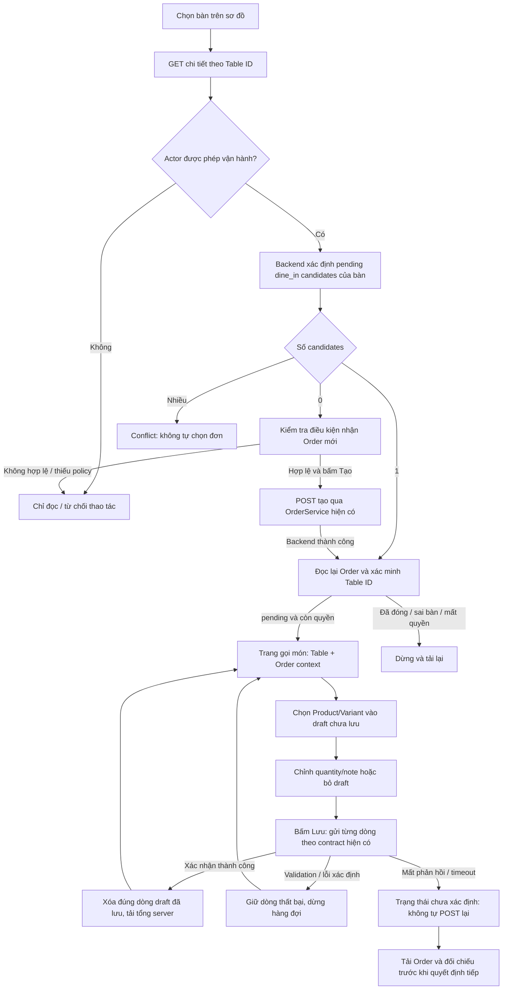

# Chuẩn bị luồng triển khai task9.5

Ngày khảo sát: 20/10/2026. Đây là thiết kế đề xuất để review, không phải phê duyệt nghiệp vụ hay implementation. Không sửa runtime source trong lượt chuẩn bị này.

## 1. Source hiện tại và điểm mới

- Area/floor/detail Admin đã có. Detail chỉ trả thông tin bàn, chưa có Order ID/Continue.
- OrderService::create có transaction, khóa Area rồi Table, kiểm tra active Area/available Table và pending dine_in Order trước khi tạo. Trạng thái bàn được backend đổi occupied trong transaction.
- Backend mới đã có OrderService::createWithItems. PosController::checkout gọi service này để tạo Order mới kèm món; không còn tự tạo Order qua persistence riêng như khảo sát cũ. Đây không phải API thêm batch vào Order đã có và không phải thanh toán.
- OrderService::addItem cho Order pending: kiểm tra active Staff, khóa Order, kiểm tra Product/Variant available, lấy giá server, lưu snapshot và tính lại tổng.
- POST /staff/orders/{order}/items nhận variant_id, quantity nguyên1..2147483647, note tùy chọn tối đa500 ký tự. Thành công redirect về staff.orders.show. Đây là API từng dòng, không có request-id chống lặp.
- PATCH quantity và DELETE dòng pending đã có; topping có endpoints riêng. Không gộp draft có topping/variant/notes khác nhau.
- OrderService::transitionItemStatus gọi InventoryService::startPreparing ở pending→preparing. Draft/addItem không phải bước trừ kho; task9.5 không tự gọi Inventory hoặc tự đổi trạng thái món.
- Staff middleware/controller/FormRequests/OrderService vẫn giới hạn active Staff. Admin floor chưa sử dụng được toàn bộ các endpoints đó. Việc này cần xử lý đúng scope riêng, không chỉ đổi middleware route.

## 2. Luồng tổng thể đề xuất

Các nhánh resolver/eligibility/Admin operating rights trong sơ đồ là ĐỀ XUẤT, chưa tồn tại đầy đủ. Không coi pending candidate là policy đã được owner duyệt.

## 3. Luồng A — chuẩn bị entry từ task9.4

### Đề xuất contract đọc

Input: actor đã xác thực, table_id thật. Backend xác minh quyền; Table/Area chưa xóa. Trả snapshot Table, Area và trạng thái khả dụng của thao tác.

Candidate baseline cần duyệt: orders.table_id = table.id AND order_type=dine_in AND status=pending. Không dùng unpaid/payment làm active definition, không latest()/first() tùy ý.

| Kết quả | Giao diện đề xuất | Backend cần bảo đảm |
| --- | --- | --- |
| Không candidate | Có thể đề nghị tạo nếu đủ điều kiện đã duyệt | Kiểm tra lại ở POST; không tạo bằng GET |
| Một candidate | Mở đúng Order ID | Xác minh liên kết Table và quyền trên mỗi request |
| Nhiều candidates | Báo conflict, không tự mở hoặc gộp/xóa | Owner quyết định có hợp lệ nhiều Order hay dữ liệu lỗi |
| Occupied nhưng không candidate | Báo cần kiểm tra | Không tự release/create |
| Available nhưng có candidate | Báo lệch trạng thái; không tạo mới | Không tự đổi Table status để khớp UI |
| Maintenance/inactive/deleted Area | Chỉ đọc hoặc từ chối theo policy | Không tạo mới; Continue khi có đơn cần policy riêng |

Tạo mới: chỉ bấm xác nhận mới POST staff.orders.store (sau khi actor contract được giải quyết). Backend trả redirect có real Order ID, đọc lại Order và table_id trước khi vào gọi món. Không dùng createWithItems để thêm món vào một Order có sẵn.

Reservation: cần owner chốt khoảng kiểm tra cho walk-in và trường hợp arrived gắn Order. Không tự mặc định bàn available là không xung đột Reservation. Khi policy chưa rõ, không bật Create tại luồng mới; có thể review triển khai Continue-only trước.

## 4. Luồng B — mở trang gọi món

ĐỀ XUẤT route đọc tường minh chứa cả ID, ví dụ GET /staff/tables/{table}/orders/{order}/menu. Đây chưa phải route hiện có và cần review trước khi thêm; không tạo một Admin route proxy để vượt Staff guard.

Backend phải xác minh:

1. Actor được phép và đang active.
2. Table/Area tồn tại theo visibility policy.
3. Order tồn tại, order_type=dine_in, order.table_id khớp Table ID.
4. Order pending mới được thêm món; completed/cancelled chỉ đọc hoặc từ chối chỉnh sửa theo contract.
5. Không lấy Order ID từ draft làm nguồn tin cậy.

Hiển thị Table code, Area, persisted status, Order code/ID và Saved Items. Nhận total/subtotal/discount/tax từ backend dưới dạng tiền decimal. Không dùng session pos_cart chung cho nhiều bàn làm draft của Order hiện có.

Danh sách sản phẩm: tái sử dụng Product/Variant, giá variant, availability và imageUrl; eager-load Category/variants. Lọc theo tên Product và category_id thật, phân trang hoặc giới hạn phù hợp. Category inactive/xóa mềm và điều kiện inventory-saleability cần đối chiếu owner policy, không tự đặt thêm quy tắc.

## 5. Luồng C — soạn draft

Đề xuất baseline UI để duyệt: draft chỉ trong memory của trang, khóa theo Order ID; chưa ghi database hoặc localStorage. Cảnh báo trước khi rời trang nếu còn draft. Reload sẽ mất draft sau cảnh báo; nếu cần lưu qua reload phải duyệt storage/lifetime riêng.

Mỗi dòng có client_line_id, variant_id, quantity, note và dữ liệu hiển thị từ Catalog. Không gửi unit_price/final total có thẩm quyền. Không tự gộp các dòng khác variant/options/notes.

- Add: thêm draft, không POST Order Items.
- Quantity: validation UI theo backend1..2147483647; server vẫn kiểm tra.
- Note: tối đa500 ký tự, render dạng text; không chèn HTML.
- Remove: chỉ xóa draft. Saved Items sửa/xóa bằng endpoints đã có và điều kiện pending của backend.
- Estimate: ghi rõ tạm tính, không trộn Saved subtotal với draft subtotal như tổng chính thức. Có thể bỏ estimate thay vì dùng tính tiền không chính xác.
- Topping: giữ thao tác đã có riêng cho saved lines; draft topping chưa có contract batch. Không giả vờ topping draft được lưu cùng addItem.

## 6. Luồng D — lưu món vào Order đã có

Đề xuất dùng endpoint addItem hiện có, save TUẦN TỰ từng dòng để không sửa OrderService hoặc tuyên bố atomic batch.

| Tình huống | Xử lý đề xuất |
| --- | --- |
| Đang gửi | Khóa Save và sửa dòng đang gửi; không phát sinh nhiều request do đổi quantity |
| Thành công được xác nhận | Xóa đúng dòng draft đã gửi; tải Saved Items và tiền server; sau đó gửi dòng tiếp |
| Validation/không còn bán | Giữ dòng lỗi và các dòng chưa gửi; không xóa lại dòng đã lưu |
| Một số dòng đã lưu | Thông báo số dòng lưu được/thất bại; không nói toàn bộ thành công |
| Order đóng/mất quyền | Dừng hàng đợi, giữ draft để đối chiếu; không ép gửi lại |
| Timeout/mất phản hồi/5xx | Coi kết quả có thể chưa xác định; KHÔNG tự retry POST; đọc lại Order và yêu cầu kiểm tra |
| Giá đổi trước khi gửi | Backend tính giá thực tế; hiển thị Saved snapshot mới; không ghi đè bằng giá draft |

Lưu ý transport: hiện controller trả redirect/HTML và validation errors, không phải JSON item receipt. Có thể dùng native form cho một dòng để tái sử dụng contract; nếu cần hàng đợi nhiều dòng dùng fetch thì phải thiết kế rõ response/redirect/error parsing, tránh suy ra thành công chỉ từ HTTP200 sau redirect. Đề xuất owner bổ sung response có saved_item_id/request token nếu cần tự động hóa chắc chắn. Chưa duyệt transport thì chưa bật multi-line Save.

Disable UI không chống được hai tab/hai máy hoặc retry mạng. Locks của addItem bảo vệ tính lại tiền nhưng không khử request lặp. Không hứa exactly-once; idempotent receipt/backend là dependency nếu yêu cầu tuyệt đối không trùng.

## 7. Scope triển khai đề xuất theo dependency

| Bước | Scope | Điều kiện kết thúc |
| --- | --- | --- |
| P1 | Quyền vận hành Admin/Staff nhất quán ở đúng module Auth/Order/Inventory liên quan | Test quyền qua route/controller/request/service; không vượt kiểm tra active |
| P2 | Task9.4 resolver + Continue-only, rồi Create khi policy sẵn sàng | Table→Order identity, none/one/multiple/stale được kiểm thử |
| P3 | Task9.5 menu/Saved Items/draft, sau đó single-item save | Backend thật, price tampering/closed Order/invalid quantity được kiểm thử |
| P4 | Multi-line save nếu transport/partial/retry contract đã duyệt | Không mất draft hoặc resend dòng đã lưu; kết quả không xác định có xử lý |

File dự kiến sau khi review: entry/detail query/controller/view, một route đọc gọi món trong phạm vi actor đã duyệt, Blade/components/CSS/JS scoped, tests TableOrderIntegrationTest. Tái sử dụng write routes/OrderService; không tạo service persist món mới. Không sửa runtime trong bước chuẩn bị này.

## 8. Test plan trước khi nhận hoàn thành

- Actor Admin/Staff active, Guest, actor bị khóa; mỗi guard thật phải được kiểm tra.
- Zero/one/multiple pending candidates; completed/cancelled, sai Table ID, bàn/Area xóa mềm, inactive/maintenance, Reservation theo policy đã duyệt.
- GET chọn bàn/menu không ghi database hoặc tạo Order.
- Catalog thật, search/category kết hợp, soft deletes/availability/variants, không N+1.
- Add/update/remove draft không lưu món; rời trang có cảnh báo; phân tách draft theo Order.
- Save món hợp lệ; quantity0/âm/quá giới hạn, note quá500, variant sai, price tampering, Product đổi giá/ngừng bán.
- Saved Items/totals khớp server, partial failure giữ đúng phần chưa lưu, timeout không auto retry, double-click không gửi lặp từ cùng UI.
- Concurrent edits/Order đóng khi đang soạn; idempotency không hỗ trợ phải ghi risk/BLOCKED.
- SQLite isolated feature fixtures; MySQL write tests chỉ schema riêng đã xác minh, không thao tác thử trên dữ liệu cần giữ.
- Build; browser1440/768/375px và keyboard; regression task9.2–9.4 và POS.

## 9. Các điểm cần duyệt trước khi code phần phụ thuộc

1. Phạm vi actor: hoàn thiện quyền Admin dùng cùng luồng Staff theo requirements (cần scope riêng sửa các guard), hay bổ sung floor/detail Staff riêng và giữ Admin chỉ đọc?
2. Duyệt candidate baseline pending+dine_in và conflict khi có nhiều; chặn tự Create khi trạng thái lệch; Continue với maintenance/inactive cần quyết định rõ.
3. Reservation policy cho Create mới; có thể duyệt Continue-only trước để không chặn phần menu Order đã có.
4. Duyệt baseline draft memory + cảnh báo rời trang, lưu từng dòng/partial outcomes; multi-line transport và retry/idempotency phải chốt riêng.

## 10. Kết quả của lượt chuẩn bị

Đã đối chiếu source mới và chuẩn bị các luồng/contract/test plan. Source ứng dụng và database không thay đổi. Chưa chạy tests/build vì chỉ tạo tài liệu; không kế thừa kết quả test cũ thành bằng chứng cho implementation mới. Task9.5 vẫn chưa READY để báo hoàn thành cho tới khi P1/P2 và các quyết định ảnh hưởng được giải quyết. Các đề xuất trong tài liệu chưa phải policy đã duyệt. Không commit/push, không triển khai task kế tiếp.
